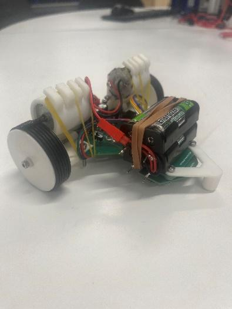

# Line Following Robot

An autonomous robot that follows a **white line on a black surface**, built for **ENMT221 - Mechatronics Design 1** at the **University of Canterbury**, Semester 2, 2026.

Group 03 A designed and built the mechanical transmission, custom electronics, sensor array, and embedded controller. The robot completed **all three demonstration runs**, with a **best lap of 17.68 seconds**, placing **12th in the cohort**.



*Final robot layout, reproduced from Figure 9 of the project report.*

## Repository contents

| File | Description |
| --- | --- |
| [LFR Documentation.pdf](LFR%20Documentation.pdf) | Full design report covering requirements, design decisions, mechanical and PCB iterations, controller development, testing, and results. |
| [Safe Final 03A.txt](Safe%20Final%2003A.txt) | Final Arduino C++ firmware, supplied as a text file. |
| [Group 03A Code.zip](Group%2003A%20Code.zip) | Archive containing an identical copy of `Safe Final 03A.txt`. |

This repository preserves the final report and firmware snapshot. Editable PCB designs, CAD models, earlier firmware versions, and a ready-to-open Arduino sketch are not included.

## Hardware and mechanical design

| Subsystem | Implementation |
| --- | --- |
| Microcontroller | ATmega4808-AFR |
| Line sensing | Five TCRT5000 reflective infrared sensors, read as analogue inputs |
| Motors | Two Multicomp MM28 DC motors |
| Motor drivers | Two BSR802N low-side N-channel MOSFET stages, controlled independently by PWM |
| Power | Four AA NiMH cells in series, nominally 4.8 V; MCP1700 regulator for the 3.3 V logic supply |
| Transmission | Single-stage friction drive: tape-wrapped motor shafts drive O-ring tyres on 3D-printed wheels |
| Structure | Main PCB doubles as the chassis; separate adjustable sensor PCB with 3D-printed supports and motor mounts |

The final transmission uses approximately **50 mm wheels**, including the O-rings, and **2.7 mm effective shaft diameters**, including electrical tape, giving an effective reduction of **18.5:1**. Rubber-band tensioning maintains contact between each shaft and wheel. Matching the tape thickness on both shafts improved straight-line consistency.

The separate sensor board allowed its distance from the wheels to be adjusted during testing. The report describes a sensor ground clearance of approximately **2.5 mm**. The course specification used a **15-20 mm white line** and a minimum bend radius of **80 mm** to the line centre.

The motor stages provide forward drive and coasting. An H-bridge was considered during development but was not implemented, so the robot cannot reverse its motors or apply active electrical braking.

## How the firmware works

The final implementation uses **proportional control**. Derivative control and weighted-average position estimation were explored during development, but the supplied firmware selects the strongest calibrated sensor and applies no derivative or integral term.

1. **Start up:** hold both motors off and flash the LED three times, with 500 ms on and 500 ms off per flash. After approximately three seconds, drive both motors at PWM 140 for 150 ms, then switch to the base speed.
2. **Read and calibrate:** read all five sensors, map each reading from its individual black/white reference values to a common range of 0-1000, and clamp it to that range. Black maps to 0 and white to 1000.
3. **Find the line:** choose the sensor with the highest calibrated value. The line is detected only when this value is greater than 850. Its index supplies one of five discrete positions: `+2`, `+1`, `0`, `-1`, or `-2`.
4. **Steer:** calculate the correction and apply it differentially to the left and right motor PWM commands.
5. **Recover:** if the line is lost, steer towards the last detected side while gradually widening the search. Resume tracking when a sensor detects the line again.

The steering calculation is:

```text
correction = constrain(18 × position, -80, 80)
base PWM   = 66 when |position| >= 1; otherwise 100
left PWM   = constrain(base PWM - correction, 0, 255)
right PWM  = constrain(base PWM + correction, 0, 255)
```

Every non-centre detected position therefore uses the lower base speed. During line loss, the commanded position is `lastDirection × max(0.6, 2.1 - 0.8 × t)`, where `t` is the number of seconds since loss. The search magnitude reaches its minimum after approximately 1.9 seconds.

The loop repeats continuously without a fixed timing schedule. The LED stays on during normal operation. Although `Serial.begin(115200)` is called, the final firmware contains no serial telemetry or command interface.

### Pin assignments and sensor order

| Output | MCU pin symbol |
| --- | --- |
| Status LED | `PIN_PD7` |
| Left motor PWM | `PIN_PA3` |
| Right motor PWM | `PIN_PA2` |

Sensor numbering differs from the order used by `read_sensors()`. The following table follows the **actual processing order in the supplied firmware**; the calibration arrays use this same order.

| Array index | Sensor constant | MCU pin symbol | Position | Black reference | White reference |
| --- | --- | --- | --- | --- | --- |
| 0 | `SENSOR_4` | `PIN_PD4` | +2 | 336 | 967 |
| 1 | `SENSOR_5` | `PIN_PD5` | +1 | 288 | 967 |
| 2 | `SENSOR_1` | `PIN_PD1` | 0 | 423 | 969 |
| 3 | `SENSOR_2` | `PIN_PD2` | -1 | 373 | 971 |
| 4 | `SENSOR_3` | `PIN_PD3` | -2 | 352 | 972 |

Section 6.2 of the report lists the opposite position sign convention. The table above matches the final code and the report's control-loop diagram; check the physical sensor and motor orientation before adapting it to another board.

## Setting up and running the firmware

1. Clone or download this repository:

   ```bash
   git clone https://github.com/ahawkins4824-blip/Line-Following-Robot.git
   cd Line-Following-Robot
   ```

2. In the Arduino IDE, create a sketch named `LineFollowingRobot` and paste in the contents of [Safe Final 03A.txt](Safe%20Final%2003A.txt). Save it as `LineFollowingRobot/LineFollowingRobot.ino`.

3. Configure an Arduino-compatible board core for the **ATmega4808** that supports the supplied `PIN_PA*` and `PIN_PD*` symbols, analogue inputs, and PWM outputs. The code uses Arduino core functions and has no explicit third-party library dependencies. The report identifies **8 MHz** as the best-performing clock setting during testing.

4. Select the programmer or bootloader upload method appropriate to the board. The custom PCB provides **UPDI** and **UART bootloader** programming headers. The exact board package, package version, fuse settings, bootloader, and programmer configuration are not recorded in this repository and must be confirmed for the target hardware.

5. Verify the pin mapping and measure black/white readings for each sensor on the intended track. Update the `black[]` and `white[]` arrays in `calibrate()` in the processing order shown above. Calibration is fixed in the source; there is no automatic calibration routine.

6. Compile and upload with the wheels clear of the surface. For a track run, position the centre sensor over the white line before resetting or powering the robot. It starts moving automatically after the three LED flashes and startup kick.

### Tuning parameters

These are the values in the supplied final firmware. PWM values are commands on a 0-255 scale, rather than measured wheel speeds.

| Parameter | Final value | Purpose |
| --- | --- | --- |
| `kp` | 18 | Proportional steering gain |
| `kd` | 0 | Declared but unused; changing it does not enable derivative control |
| `LINE_THRESHOLD` | 850 | Strongest calibrated sensor must exceed this to detect the line |
| `baseSpeed` | 100 | Base PWM for a centred line |
| Corner base PWM in `controller()` | 66 | Used whenever `abs(position) >= 1` |
| Correction limit in `controller()` | -80 to +80 | Limits the differential steering correction |
| `KICK_PWM` / `KICK_MS` | 140 / 150 ms | Initial motor startup pulse |

Recheck sensor calibration after changes to lighting, sensor height, or sensor hardware. The report also found that mechanical slip and unequal shaft wrapping could resemble controller faults, so consistent transmission contact is important when tuning gains and speeds.

## Demonstration results

All three demonstration runs completed the course without losing the line, as recorded in Section 8 of the report.

| Run | Outcome | Lap time |
| --- | --- | --- |
| 1 | Completed | 18.77 s |
| 2 | Completed | 19.11 s |
| 3 | Completed | **17.68 s** |
| Average | | 18.52 s |

The final run used a base PWM of 100 after an additional straight-line acceleration strategy in the second run produced less consistent motion. An earlier test lap of approximately 15 seconds was reported during development, but could not be reproduced reliably; **17.68 seconds is the best demonstration result**.

## Limitations and future improvements

- **Line-loss behaviour:** recovery continues indefinitely. There is no finish-line detector, automatic stop timeout, or start/stop command interface in the final firmware.
- **Transmission consistency:** friction drive depends on shaft wrapping, contact pressure, and tyre condition. The report proposes investigating a gear-based transmission to reduce slip.
- **Power stability:** motor startup and rapid acceleration caused brownouts during testing. The report identifies the approximately 0.7 V drop across the battery-to-regulator protection diode as a possible contributor and proposes a lower-drop protection solution.
- **Wireless tuning:** a Raspberry Pi Pico 2W BLE-to-UART interface was trialled but abandoned because it was unreliable. It is not part of the supplied final firmware, and the bridge code is not included.
- **Packaging:** integrating the sensor and main boards after settling on sensor placement could reduce overall size and inertia.

## Team and documentation

**Group 03 A:** Anton Hawkins, Cody Carter, Khush Patel, and James Buckland-Blair.

**Course:** ENMT221 - Mechatronics Design 1, University of Canterbury, Semester 2, 2026.

The [project report](LFR%20Documentation.pdf), dated **9 October 2026**, contains the full engineering rationale, design iterations, supporting figures, and references. Firmware behaviour and parameter values in this README have been checked against [the supplied final source](Safe%20Final%2003A.txt).
